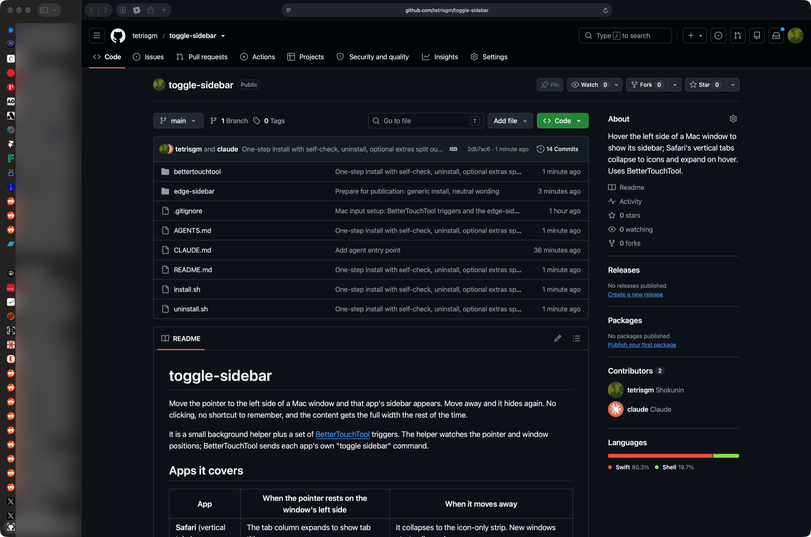
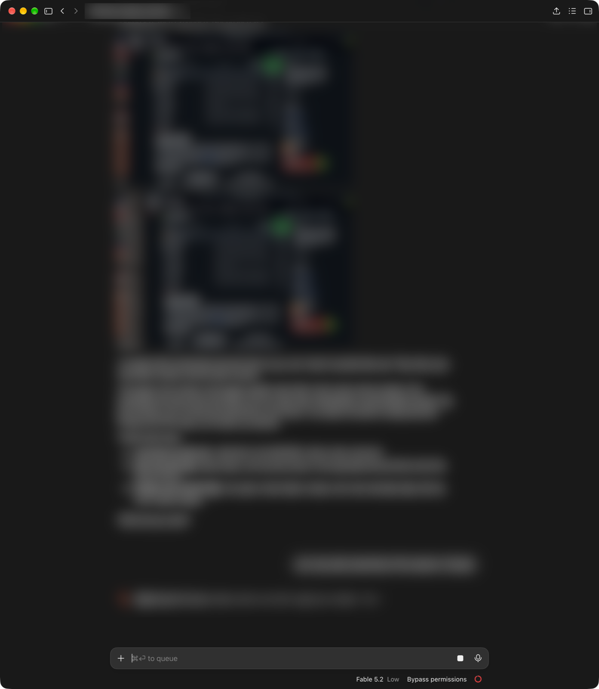
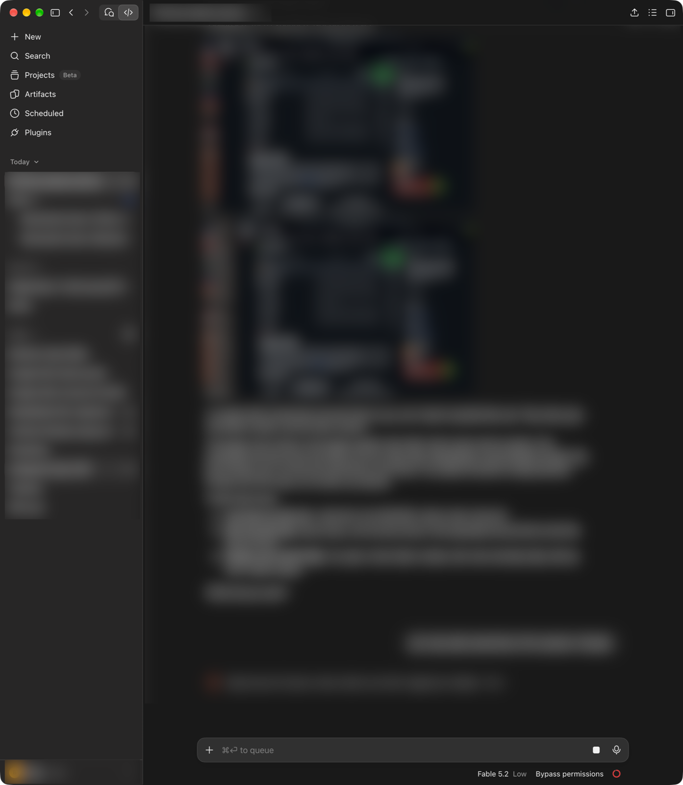

# toggle-sidebar

Move the pointer to the left side of a Mac window and that app's sidebar appears. Move away and it hides again.
No clicking, no shortcut to remember, and the content gets the full width the rest of the time.

It is a small background helper plus a set of [BetterTouchTool](https://folivora.ai) triggers. The helper watches
the pointer and window positions; BetterTouchTool sends each app's own "toggle sidebar" command.

| Pointer elsewhere | Pointer on the window's left side |
|---|---|
|  |  |
|  |  |

Safari above, the Claude desktop app below. Tab titles, session names and chat text are blurred.

## Apps it covers

| App | When the pointer rests on the window's left side | When it moves away |
|---|---|---|
| **Safari** (vertical tabs) | The tab column expands to show tab titles | It collapses to the icon-only strip. New windows start collapsed |
| **Finder** | The sidebar (Favourites, Locations, Tags) appears | It hides |
| **Notes** | The folder list appears | It hides |
| **Mail** | The mailbox list appears | It hides |
| **Music**, **TV** | The library sidebar appears | It hides |
| **Preview** | The page / thumbnail sidebar appears | It hides |
| **Reminders** | The list sidebar appears | It hides |
| **Calendar** | The calendar list appears | It hides |
| **Claude** (desktop app) | The conversation sidebar appears | It hides |
| **Codex** (desktop app) | The project / chat sidebar appears | It hides |

Safari is handled differently from the rest. Safari has no command for collapsing its vertical tab column, so the
column's width is set directly: it always ends up in the right state. Every other app gets its "toggle sidebar"
keyboard shortcut, sent once on the way in and once on the way out (see Known limits).

It works on whichever window is under the pointer, also when that app is not in front. Windows smaller than
500 × 300, the title bar and the Dock are left alone.

## Install

Requires macOS, BetterTouchTool (running, with external scripting allowed in its settings) and the Xcode command
line tools.

```sh
git clone https://github.com/tetrisgm/toggle-sidebar && cd toggle-sidebar && ./install.sh
```

`install.sh` adds the named triggers to BetterTouchTool, builds the helper into `~/bin`, installs it as a login job,
copies the app list to `~/.config/edge-sidebar.json` (kept if you already have one) and runs a self-check.
For Safari, also set View → Tab Layout → Vertical.

It only adds triggers with this repo's own UUIDs (they start `5A1C`); nothing else in your BetterTouchTool setup is
changed. It is safe to re-run, the helper needs no macOS permission of its own, and `./uninstall.sh` removes it all.

**Using an AI coding agent?** Point it at this repo and say "install toggle-sidebar". `AGENTS.md` tells it what to
run, what to verify and what to ask you.

## How it works

- `edge-sidebar/edge-sidebar.swift` checks the pointer about 25 times a second. When it rests for 0.06 s in the
  left 28 px of a listed app's window (Safari: 56 px, its whole icon strip), it fires that app's "show" trigger.
  When the pointer is more than 340 px from the window's left side, or leaves the window, it fires "hide".
  These numbers are constants at the top of the file.
- A trigger is fired by opening `btt://trigger_named/?trigger_name=…`. The named trigger in BetterTouchTool then
  sends the keyboard shortcut, or for Safari runs an AppleScript.
- An app's own small windows (tab previews, tooltips, popovers) are looked through, so hovering a Safari tab
  does not count as leaving the window.
- The helper runs as LaunchAgent `local.edge-sidebar` and logs each show/hide to `~/Library/Logs/edge-sidebar.log`.
  Create `~/.config/edge-sidebar.trace` to log what is under the pointer; delete it to stop.

### Safari's vertical tab column

The column is an accessibility splitter: `splitter 2 of splitter group 1` of the browser window. Setting its value
to 40 collapses it to the icon strip (Safari settles at about 52); setting it to the saved width expands it
(`~/.config/safari-tabcol-width`, default 210; drag the column wider once and that width is remembered).
The AppleScripts are in `bettertouchtool/scripts/` and run inside BetterTouchTool, which has the Accessibility
permission. They search all of Safari's windows, because a tab preview can be the frontmost one.
`safari_tabcol_toggle` does the same as a single toggle, free to bind to a key or gesture.

## Add or change an app

Edit `~/.config/edge-sidebar.json`. It is read live; no restart.

```json
{
  "com.apple.finder": "sidebar_opt_cmd_s",
  "com.apple.Safari": { "show": "safari_tabcol_expand", "hide": "safari_tabcol_collapse",
                        "activate": false, "collapseNew": true, "zone": 56 }
}
```

- A plain name is one named trigger used for both directions (a toggle).
- An object gives separate `show` and `hide` triggers. Optional: `activate` (false if the trigger does not need
  the app in front), `collapseNew` (run `hide` for windows that appear), `zone` (hover width in px).
- Find an app's bundle identifier with `osascript -e 'id of app "Name"'`.

Named triggers that ship in `triggers.json`:

| Named trigger | Sends | Used by |
|---|---|---|
| `safari_tabcol_expand` / `safari_tabcol_collapse` / `safari_tabcol_toggle` | AppleScript (column width) | Safari |
| `sidebar_opt_cmd_s` | Opt+Cmd+S | Finder, Notes |
| `sidebar_ctrl_cmd_s` | Ctrl+Cmd+S | Mail, Music, TV, Preview, Reminders, Calendar |
| `sidebar_cmd_b` | Cmd+B | Claude |
| `sidebar_cmd_shift_s` | Cmd+Shift+S | Codex |

An app with another shortcut needs one more named trigger in BetterTouchTool: trigger type "Named Trigger", one
"Send Keyboard Shortcut" action.

## Known limits

- **Apps other than Safari are toggled blindly.** The helper cannot see whether a sidebar is open. If you open one
  by hand, that app runs inverted (hides on approach) until you toggle it once more by hand.
- **Only the left side.** Right-hand inspectors and sidebars are not covered.
- **Safari: do not switch Tab Layout automatically.** Hiding the sidebar and then switching Vertical → Compact left
  an empty grey column in Safari 27.3 that only quitting Safari cleared.

## Optional extras

`bettertouchtool/extras.json` holds a few unrelated BetterTouchTool triggers from the same setup. They are not
installed by default: `bettertouchtool/restore.sh extras.json` adds them.

| Input | Result |
|---|---|
| 3-finger swipe left / right | Snap the window under the pointer to the left / right half of the screen |
| 3-finger swipe up / down | Mission Control / Show Desktop (turn the macOS three-finger gestures off in System Settings → Trackpad → More Gestures) |
| 2-finger spread | Maximise / restore the window under the pointer (only fires while macOS "Zoom in or out" is on) |
| Home / End | Send Cmd+Up / Cmd+Down |

`IF` actions carry an archived NSPredicate in `BTTIfConditionData`; `bettertouchtool/pred.swift` generates it from a
format string.
